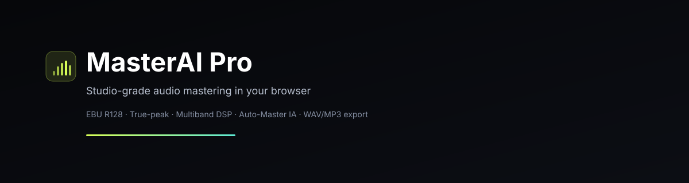

# MasterAI Pro



[](https://github.com/leeandres/remasterizado/releases)
[](LICENSE)
[](https://github.com/leeandres/remasterizado/releases)
[](https://github.com/leeandres/remasterizado)

**Versión actual: 1.0.1** — App de escritorio con auto-actualización disponible en [Releases](https://github.com/leeandres/remasterizado/releases).

**MasterAI Pro** es un estudio de masterización de audio profesional que funciona **100% en el navegador**. Permite subir una mezcla, analizarla con estándares EBU R128, aplicar una cadena DSP completa (filtro, EQ paramétrico, compresor multibanda, saturación y limitador true-peak), comparar el original con el resultado masterizado en tiempo real y exportar el archivo final listo para streaming (Spotify, Apple Music, YouTube, SoundCloud).

Todo el procesado, la medición y la codificación ocurren en el dispositivo del usuario: **ningún audio se sube a ningún servidor**.

---

## Características principales

- **Carga de audio**: MP3, WAV y FLAC (hasta 500 MB). Validación de tasa de muestreo (44.1/48 kHz) y conversión interna a 48 kHz.
- **Análisis de origen**: LUFS integrada, true peak (4×), LRA, crest factor y balance espectral (EBU R128).
- **Cadena DSP profesional**:
  - Ganancia de entrada/salida
  - Filtro high-pass / low-pass (biquad 12 dB/oct)
  - EQ paramétrico de 5 bandas (low shelf, 3 peaking, high shelf) con editor gráfico arrastrable
  - Compresor broadband o multibanda (3 bandas) con medidor de ganancia reducida
  - Saturación armónica (tanh) con curva en tiempo real
  - Limitador brickwall true-peak con techo fijo −1.0 dBTP
- **Auto-Master IA**: analiza la mezcla y ajusta automáticamente los seis módulos según el género y la plataforma.
- **Comparación A/B**: alterna entre original y masterizado sin cortes (botones A/B, atajo `B`, indicador de estado).
- **Analizadores en vivo**: espectro FFT (4096, escala logarítmica, peak hold), editor EQ gráfico, goniómetro/fase y correlación.
- **Medidores en vivo**: LUFS integrada/short-term, true peak, correlación, L/R y ganancia reducida.
- **Waveform interactivo**: zoom, seek, selección de regiones y loop.
- **Análisis offline**: render de prueba con métricas antes/después y verificación del objetivo.
- **Exportación**: WAV 24-bit/48 kHz o MP3 320 kbps CBR, normalización iterativa al objetivo de la plataforma, exportación de pista completa o región seleccionada.
- **Historial local**: hasta 8 masters guardados en IndexedDB con ajustes y archivo final, descarga y restauración de configuración.
- **Centro de ayuda integrado**: guía completa de cada función (botón `?` o tecla `?`).
- **App de escritorio**: ejecutables para Windows y macOS con auto-actualización desde GitHub Releases.
- **Atajos de teclado**: Espacio (play/pausa), B (A/B), L (loop), E (exportar), H (historial), ? (ayuda).
- **UI responsive** (mobile-first) con tema oscuro de estudio.

---

## Requisitos

- Node.js 20+
- Navegador moderno con soporte de Web Audio API, AudioWorklet y (opcional) decodificación FLAC nativa.

## Instalación y ejecución

```bash
npm install
npm run dev
```

Abre `http://localhost:3000`.

Para producción:

```bash
npm run build
npm run start
```

---

## Uso rápido

1. Sube tu mezcla (WAV/MP3/FLAC).
2. Elige el género y la plataforma de destino en el panel izquierdo.
3. Pulsa **Auto-Master IA** para una cadena inicial.
4. Escucha con los botones **A / B** para comparar original y master.
5. Ajusta los módulos manualmente si es necesario.
6. Pulsa **Analizar** para verificar LUFS y true peak.
7. Exporta en WAV o MP3.

---

## App de escritorio (Windows y macOS)
### Descarga directa (v1.0.1)

| Plataforma | Archivo | Enlace |
|---|---|---|
| macOS | `MasterAI-Pro-1.0.1.dmg` | [Descargar DMG](https://github.com/leeandres/remasterizado/releases/download/v1.0.1/MasterAI-Pro-1.0.1.dmg) |
| Windows | `MasterAI-Pro-1.0.1.exe` | [Descargar EXE](https://github.com/leeandres/remasterizado/releases/download/v1.0.1/MasterAI-Pro-1.0.1.exe) |

> Si en la página de Releases no ves los archivos, haz clic en **"Assets"** para expandir la lista. El `.blockmap` es opcional (solo para auto-update diferencial).

> **Nota sobre los archivos de release:** además del instalador (`.dmg`/`.exe`) verás un archivo `.blockmap`. Es un auxiliar de auto-actualización para descargas diferenciales (delta updates); **no necesitas descargarlo manualmente**, solo el `.dmg` o `.exe`.


MasterAI Pro también está disponible como aplicación de escritorio con **auto-actualización**:

- **macOS**: descarga el `.dmg` desde [GitHub Releases](https://github.com/leeandres/remasterizado/releases) e instálalo arrastrando a Aplicaciones.
- **Windows**: descarga el `.exe` portable desde [GitHub Releases](https://github.com/leeandres/remasterizado/releases) y ejecútalo (no requiere instalación).

La app comprueba automáticamente si hay una versión nueva al iniciar, la descarga en segundo plano y la instala al reiniciar, notificando al usuario en cada paso.

---

## Centro de ayuda integrado

La aplicación incluye un **Centro de ayuda** completo (icono `?` en el encabezado o tecla `?`) que documenta cada función:

- **Cargar audio**: formatos, límites, metadatos y análisis de origen.
- **Reproducción y transporte**: play/pausa, detener, loop, seek, volumen.
- **Comparar original vs. remasterizado (A/B)**: botones A/B, atajo B, indicador de estado, comparativa numérica y medidores en vivo.
- **Waveform y regiones**: zoom, selección y loop por región.
- **Analizadores**: espectro FFT, EQ gráfico (arrastrar nodos, doble clic para resetear), goniómetro/fase.
- **Cadena DSP**: descripción de cada módulo y su activación/desactivación.
- **Auto-Master IA**: qué hace, informe y edición posterior.
- **Análisis offline**: render de prueba, objetivo y techo.
- **Exportación**: formatos, normalización, selección, progreso y resultado.
- **Historial local**: abrir, descargar, cargar ajustes, eliminar.
- **Atajos de teclado**.
- **Consejos y buenas prácticas**.

---

## Objetivos de entrega

| Plataforma   | Objetivo LUFS | Techo true peak |
|--------------|---------------|-----------------|
| Spotify      | −14 LUFS      | −1.0 dBTP       |
| Apple Music  | −14 LUFS      | −1.0 dBTP       |
| YouTube      | −13 LUFS      | −1.0 dBTP       |
| SoundCloud   | −9 LUFS       | −1.0 dBTP       |

---

## Tecnologías

- Next.js 16, React 19, Tailwind CSS 4
- Zustand (estado)
- Web Audio API, OfflineAudioContext, AudioWorklet
- wavesurfer.js (waveform)
- @breezystack/lamejs (codificación MP3 en Web Worker)
- idb (IndexedDB para historial)

## Privacidad

Todo el procesado y la codificación ocurren en el navegador. Los archivos nunca salen del dispositivo.

## Licencia

MIT (ver `LICENSE`).
